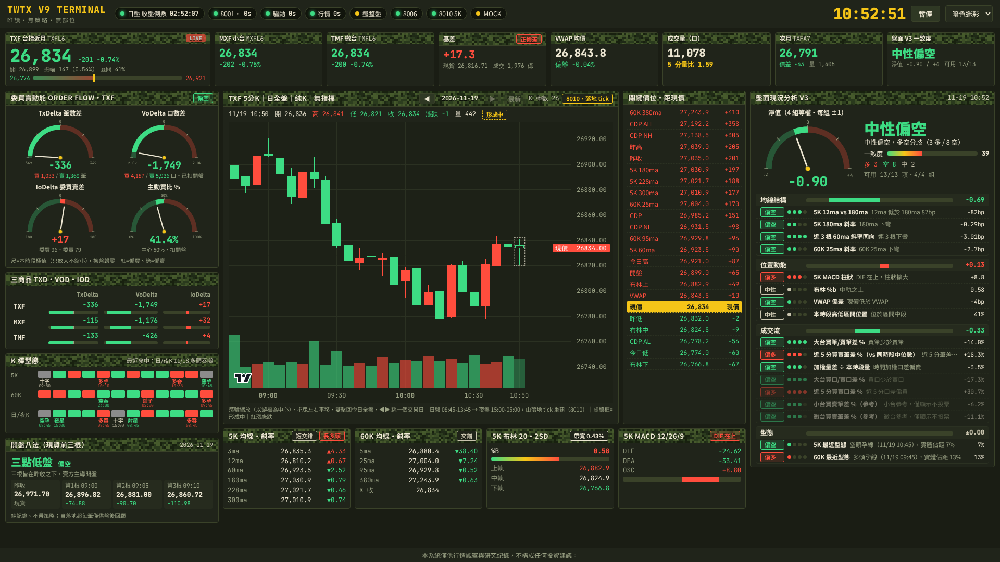
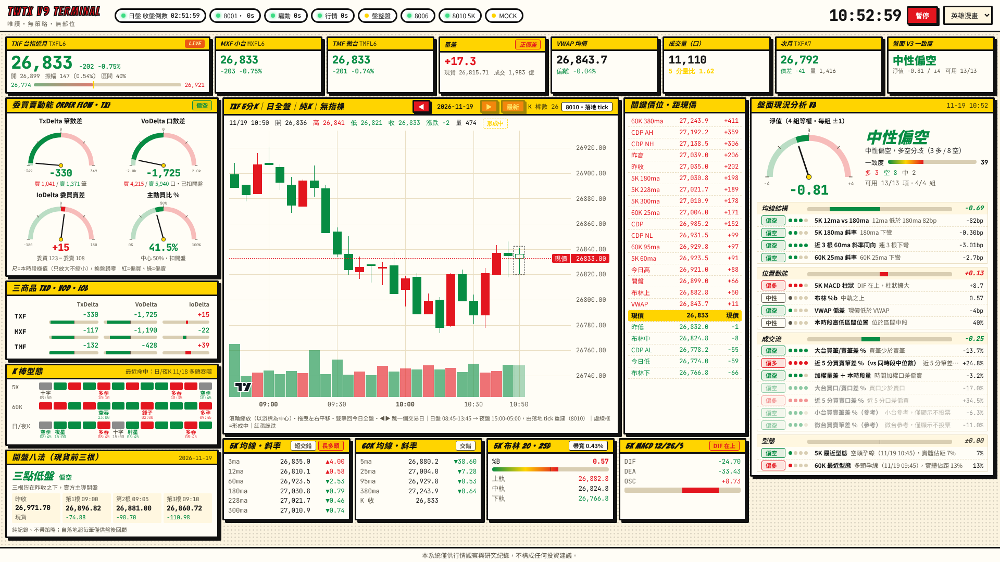

# TWTX V9 台指期盤面終端（唯讀・無策略・無部位）

以永豐 **Shioaji** 取得台指期即時行情的盤面監看終端。只呈現行情、籌碼流、技術面與盤面綜合判讀，
**不含下單、不含策略訊號、不含部位管理**；所有判讀文字皆為描述性。

> 本系統僅供行情觀察與研究紀錄，不構成任何投資建議。

| 暗色迷彩（預設） | 英雄漫畫 |
|---|---|
|  |  |

---

## 1. 快速開始

需求：Python 3.11+、Node.js 18+（僅建置前端時需要）。

```bash
# macOS / Linux
./start.sh
# Windows
start.bat
```

腳本會：建立 `.env`（若不存在）→ 建立 `.venv` 並安裝套件 → 建置前端（首次或原始碼有更新時）→ 啟動後端。
開啟 <http://127.0.0.1:8001>。**未設定 API Key 時自動進入 Mock 模式**，開啟即可看到動態畫面
（休市時 Mock 以虛擬時鐘重播最近一個日盤，從 10:52 開始播放）。

手動啟動：

```bash
cp .env.example .env
python -m venv .venv && . .venv/bin/activate
pip install -r backend/requirements.txt          # Live 模式改用 requirements-live.txt
(cd frontend && npm install && npm run build)
cd backend && python -m twtx
```

前端開發（熱更新）：後端照常啟動後，另開 `cd frontend && npm run dev`，開 <http://localhost:5173>
（`/api`、`/ws` 自動代理到 `API_PORT`）。

## 2. 架構

```
永豐 Shioaji（Python）── tick / bidask / 指數回呼：只入列，不運算
   ▼  loop.call_soon_threadsafe → asyncio.Queue
後端 Data Engine（FastAPI, asyncio）
   ├─ 落地  backend/twtx/storage.py   每筆 tick → data/<mode>/ticks/YYYYMMDD.sqlite（依交易日，夜盤歸次一交易日）
   ├─ 計算  kbar / indicators / flow / patterns / opening8 / scoring
   └─ 推播  WebSocket /ws：每 1 秒 snapshot；每批 tick 推 5K 增量
   ▼
前端（React + TypeScript + Vite）
   ├─ K 線：lightweight-charts 4.2.3（只繪圖，資料一律來自後端）
   └─ 儀表：SVG 自繪半圓 gauge
```

| 檔案 | 職責 |
|---|---|
| `backend/twtx/feeds/shioaji_feed.py` | Live 連線、合約解析、訂閱、斷線重登、歷史補齊、`ReadOnlyApi` 唯讀防護 |
| `backend/twtx/feeds/mock.py` | Mock 行情：產生與 `TickFOPv1` / `BidAskFOPv1` / `QuoteIdxV1` 欄位完全相同的物件 |
| `backend/twtx/ticks.py` | **欄位對應**（內外盤方向）與 Mock 物件定義 |
| `backend/twtx/session.py` | 日盤 / 夜盤 / 交易日歸屬 / 倒數 |
| `backend/twtx/kbar.py` | 由落地 tick 重建 5K / 60K / 日夜K |
| `backend/twtx/flow.py` | TxDelta / VoDelta / IoDelta / 主動買比，極值尺只放大、換盤歸零 |
| `backend/twtx/scoring.py` | 盤面 V3 計分（參數全部可調） |
| `backend/twtx/engine.py` | 彙總快照、關鍵價位、5 分量比、對帳函式 |
| `backend/twtx/backfill.py` | 啟動補齊（落地 → Shioaji 歷史）與收盤後 kbars 對帳 |
| `backend/twtx/schema.py` ⇄ `frontend/src/schema.ts` | JSON schema，兩邊由測試強制一致 |

### 服務埠（`.env`）

| 變數 | 預設 | 用途 / 狀態膠囊 |
|---|---|---|
| `API_PORT` | 8001 | WebSocket `/ws`、REST `/api/*`、前端靜態檔；膠囊 `8001・Ns`＝距上次快照秒數 |
| `ENGINE_PORT` | 8006 | `GET /health` 資料引擎健康；膠囊 `8006` |
| `STORE_PORT` | 8010 | 落地 tick 服務：`/health`、`/days`、`/ticks?day=YYYY-MM-DD&product=TXF`；膠囊 `8010 5K`（滑鼠停留看寫入筆數） |

其他膠囊：`行情 Ns`＝距上次收到 tick 秒數；`驅動 Ns`＝tick 入列到計算完成的延遲；`盤整盤/趨勢盤`＝描述性盤態。
綠＝正常、黃＝延遲（或休市）、紅＝斷線。

## 3. Shioaji 憑證與 Live 模式

1. 於永豐 API 管理頁申請 **API Key / Secret Key**（唯讀終端**不需要 CA 憑證**，也不需要開啟交易權限）。
2. 編輯 `.env`：

   ```ini
   TWTX_MODE=live
   SJ_API_KEY=你的key
   SJ_SECRET_KEY=你的secret
   SJ_SIMULATION=false      # 開發期可設 true 使用 Shioaji 模擬環境
   ```
3. `./start.sh`（偵測到金鑰會改裝 `requirements-live.txt`）。

金鑰只存在後端 `.env`；`/api/config` 只回傳模式與埠號，前端拿不到任何憑證。

**Mock / Live 切換**：`TWTX_MODE=mock|live`。留空時「有金鑰→live，無金鑰→mock」；設為 live 但缺金鑰時仍退回 mock。
Mock 與 Live 的落地資料分開存放（`data/mock/`、`data/live/`），Mock 每次啟動重新產生。

### 連線細節（依已安裝版本的實際簽名）

開發時 `sinotrade.github.io` 被網路政策擋下，無法讀取 `llms-full.txt`；程式依**已安裝的 shioaji 1.7.11** 型別定義
（`_core.pyi`）實作，並對舊版自動退回：

| 項目 | 1.7.x（主要） | 舊版退回 |
|---|---|---|
| 合約 | `api.Contracts.Futures["TXFR1"]`（亦嘗試 `.get()`、`.TXF.TXFR1`） | 同左 |
| 指數 | `api.Contracts.Indexs.TSE["001"]` | `.TSE.TSE001` |
| 訂閱 | `api.subscribe(c, quote_type=QuoteType.Tick, version=QuoteVersion.v1)` | `api.quote.subscribe(...)` |
| 回呼 | `set_on_tick_fop_v1_callback(cb)`，cb 收 **1 個參數** | `(exchange, tick)` 兩參數，皆以 `args[-1]` 取 tick |
| 指數行情 | `QuoteType.Quote` + `on_quote_idx_v1`；無推送時每 5 秒 `api.snapshots` 補 | 基差改用 `tick.underlying_price` |
| 斷線 | `set_session_down_callback` → 指數退避重登並重新訂閱；`set_event_callback` 12＝重連中、13＝已重連 | `api.quote.set_event_callback` |
| 登入 | `login(api_key, secret_key, subscribe_trade=False)` | 不支援該參數時去掉 |

**唯讀強制**：原始碼不呼叫 `activate_ca` / `place_order` / `update_order` / `cancel_order` 或任何帳務函式；
`tests/test_readonly.py` 掃描整個套件，`ReadOnlyApi` 也會在執行期攔下這些屬性。
訂閱數共 8 筆（4 Tick＋3 BidAsk＋1 指數），歷史查詢間隔 0.25 秒，遠低於官方上限。

## 4. 欄位對應（已寫單元測試 `tests/test_field_mapping.py`）

| 介面指標 | 計算 |
|---|---|
| TxDelta 筆數差 | `tick_type==1`（外盤＝主動買）筆數 − `tick_type==2`（內盤＝主動賣）筆數；`0` 不計 |
| VoDelta 口數差 | 同上累加 `volume`，扣除開盤集合競價第一筆 |
| 主動買比 % | 外盤量 ÷（外盤量＋內盤量），扣開盤；另以 `ask_side_total_vol`（外盤）/ `bid_side_total_vol`（內盤）交叉驗證（滑鼠停留可見） |
| IoDelta | 最新 BidAsk `bid_total_vol − ask_total_vol` |
| VWAP | `tick.avg_price`，並以自算 Σpv/Σv 交叉驗證（VWAP 卡片滑鼠停留可見差值） |
| 基差 | TXF − 加權指數（無指數時用 `underlying_price`） |
| 次月價差 | TXFR2 − TXFR1 |
| 5 分量比 | 本根 5K 量 ÷ 過去 `VOLUME_RATIO_DAYS` 日同時段（同盤別同槽位）平均；形成中依已過時間比例折算（下限 20%） |
| `simtrade==True` | 試撮：照樣落地（帶旗標）但**不進任何計算與 K 棒** |

## 5. 資料與時段規則

- 日盤 08:45–13:45、夜盤 15:00–次日 05:00；收盤分鐘（13:45:xx / 05:00:xx）的成交併入最後一根。
- 夜盤歸屬次一交易日（週五夜盤 → 週一）；休市日以 `HOLIDAYS` 設定。換盤時 Delta 與極值尺全部歸零。
- 「昨高/昨低/昨收」與 CDP 取**最近一個已完成的日盤**。
- K 棒全部由落地 tick 重建，不採用券商 K 線；Live 模式於每盤收盤 5 分鐘後以 `api.kbars` 1 分 K 聚合成 5K 比對，
  差異寫入 `logs/reconcile.log`（假設 Shioaji 1 分 K 時間戳為該分鐘結束時刻，已平移 −1 分）。
- 近月轉倉：結算日（第三個週三）後 TXFR1 指向新近月，卡片代碼同步更新，K 線於轉倉處畫垂直虛線。
- 啟動補齊：先重播近 25 個交易日的落地 tick；缺的交易日以 `api.ticks` 補（TXF），當日以四個商品的 `api.ticks`
  補到最新並以時間戳去重銜接；60K 380ma 等資料不足的項目在盤面 V3 標記「不可用」。
- 斷線：畫面保留最後數值並加「資料延遲」遮罩，WebSocket 自動重連並重抓 K 線補齊缺口。

## 6. 盤面 V3 計分（`backend/twtx/scoring.py`）

- 每項輸出 `{direction: +1/0/−1, strength: 1–4, value, text, voting, available}`
- 組分數＝組內「投票且可用」項目 `direction × strength / 4` 的平均（±1）；淨值＝四組加總（±4）
- 一致度＝|多數方項數 − 少數方項數| ÷ 可用項數 × 100
- 判讀：|淨值| < 0.5 中性；0.5–1.5 中性偏X；1.5–3 偏X；> 3 極偏X

| 組 | 投票項（共 13） | 僅顯示不投票 |
|---|---|---|
| 均線結構 | 12ma vs 180ma（bp）、180ma 斜率、近 3 根 60ma 斜率同向、60K 25ma 斜率 | |
| 位置動能 | MACD 柱、布林 %b、VWAP 偏差、本時段高低區間位置 | |
| 成交流 | 大台買賣筆差 %、近 5 分筆差 %（減本時段 5K 筆差中位數）、時間加權口差 ÷ 本時段量（半衰期 30 分） | 大台口差 %、近 5 分口差 %、小台/微台筆差 % |
| 型態 | 5K 最近 3 根內型態 × 實體佔距比、60K 同上 | |

**調參**：建立 JSON 並於 `.env` 設 `SCORING_PARAMS_FILE=/path/params.json`，只需寫要覆蓋的鍵：

```json
{
  "items": {
    "vo_pct": { "voting": true },
    "tx_pct": { "th": [1, 4, 8, 15] }
  },
  "verdict": { "neutral": 0.6, "lean": 1.5, "strong": 3.0 },
  "consistency": { "high": 70, "mid": 40 },
  "pattern_lookback": 3
}
```

`th` 為 `[t1, t2, t3, t4]`：|x| < t1 為中性，≥ t1 強度 1、≥ t2 強度 2…（單位見各項：bp、%、點/根）。

## 7. 測試

```bash
pip install -r backend/requirements-dev.txt
cd backend && python -m pytest -q
```

涵蓋：欄位對應與內外盤方向（含與已安裝 shioaji 類別比對）、時段切換 / 夜盤歸屬 / 週五夜盤、K 棒重建與收盤分鐘、
Delta 與極值尺、計分模組、型態 / 開盤八法、唯讀硬性檢查、`schema.py` ⇄ `schema.ts` 一致性、實際快照符合 schema。

## 8. 互動

滾輪縮放（以游標為中心）・拖曳平移・雙擊回今日全盤・`←` `→` / ◀▶ 跳交易日・`最新` 回到即時・`暫停` 凍結畫面但背景持續收資料。
寬度 < 1200px 自動改為單欄。主題在右上角切換（也可 `?theme=comic`），只換 CSS 變數。

## 9. 實盤驗證清單（開發順序第 5 步，需於盤中以真實帳號進行）

本專案已用 Mock 與單元測試驗證，但**尚未以真實 Shioaji 帳號連線驗證**。首次 Live 執行時請逐項比對券商看盤軟體：

- [ ] 合約解析與 TXFR1 實際代碼（卡片顯示，如 TXFL6）、tick 回呼的 `code` 是否對到商品（log 會印出）
- [ ] 內外盤比 / 主動買比、TxDelta、VoDelta
- [ ] VWAP（`avg_price` 與自算差值）
- [ ] 5K / 60K OHLCV 與 `logs/reconcile.log` 對帳結果
- [ ] 指數現價與成交金額單位（`SPOT_AMOUNT_DIVISOR`）
- [ ] 拔網路線測試：狀態燈轉紅、遮罩出現、恢復後自動重登補齊
